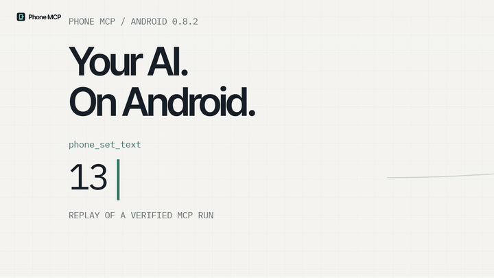
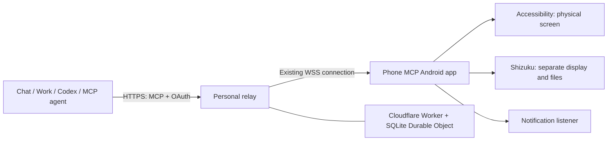

<div align="center">

<h1></h1>

**Give your AI a real Android phone to work with.**

Read app interfaces. Tap, type and swipe. Work on a separate display.
Transfer files. Install an APK. Keep the controls on your phone.

[**Watch the launch film ↗**](https://github.com/Mirochill/Phone-MCP/releases/download/v0.8.2/phone-mcp-launch.mp4) · [**Download Android 0.8.2**](https://github.com/Mirochill/Phone-MCP/releases/latest) · [**Installation**](docs/installation.md) · [**Agent setup prompt**](docs/agent-setup-prompt.md)


</div>

## Watch it in motion

https://github.com/user-attachments/assets/1b6dd7ad-868c-4561-a8e3-cca08a2036df

*22 seconds · sound on. Remotion camera choreography, actual Android captures and illustrated tool routes. [Download the MP4 for reuse](https://github.com/Mirochill/Phone-MCP/releases/download/v0.8.2/phone-mcp-launch.mp4) · [Editable Remotion source](docs/media/remotion/README.md).*

<details><summary>Animated preview if the video player is unavailable</summary>



</details>

Phone MCP connects an Android companion app to an AI client through the [Model Context Protocol](https://modelcontextprotocol.io/). A personal relay exposes authenticated tools over HTTPS; the phone makes an outbound WebSocket connection. With the Cloudflare deployment, the relay keeps running when your computer is off. **The AI still runs in your chosen client**: this project does not host a model or create an autonomous agent that keeps working after your conversation ends.

This repository contains the **original editable Android source files**, AIDL interfaces and resources, both server implementations, locked dependencies, tests, setup guides, the compiled APK, and launch media. The Android source is the buildable source of truth; the additional [APK inspection package](docs/source-provenance.md) is generated decompiler output and has documented limitations.

## See it

<p align="center">


</p>

*The first two images are real captures in an isolated test emulator; the third is a real S24 Ultra calculator result obtained through Phone MCP in Codex. The current Android app interface is in French; the documentation is in English. Display diagrams and API routes in the launch film are illustrative; they do not turn the paused session/files captures into proof of a new transfer or installation.*

## What the AI can do

| Capability | Tools | What actually happens |
|---|---|---|
| Check availability | `phone_connection`, `phone_status` | Reports the real connection, session, active mode, permissions and display readiness. |
| Understand an app | `phone_snapshot`, `phone_screenshot` | Reads accessible elements or captures the authorized app window. Password fields are protected; secure windows can refuse capture. |
| Navigate and interact | `phone_open_app`, `phone_open_url`, `phone_click`, `phone_long_press`, `phone_set_text`, `phone_scroll`, `phone_back` | Opens an authorized app or HTTPS URL and uses elements from a recent snapshot. Actions normally include a fresh `observation` for the next step. |
| Handle canvas and game interfaces | `phone_tap`, `phone_swipe` | Uses observed coordinates within the authorized window. Gestures work in foreground mode on APK 0.8+ and on the separate display. Successful gameplay depends on the game, model and latency. |
| Change or recover the display | `phone_set_control_mode` | Explicitly selects foreground or parallel mode, or recreates a stopped separate display inside an already authorized session. |
| Read and reply to notifications | `phone_notifications`, `phone_reply_notification` | Reads active notifications and uses a compatible inline reply action without opening the app. Delivery depends on the app. |
| Download and track files | `phone_files_list`, `phone_download_file`, `phone_file_job` | Downloads a direct HTTPS URL into `Download/PhoneMCP`, reports progress and supports cancellation while a transfer is pending. Maximum file size: 512 MiB. |
| Install or update an app | `phone_install_apk` | Installs one previously transferred APK through Shizuku after checking its SHA-256 and expected package name. Android validates its signature. No app permissions are automatically granted. |
| End access | `phone_stop` | Stops the session. Starting another session requires an action on the phone. |

The server advertises **21 tools**. See the [tool contract and examples](docs/tools.md) for snapshot freshness, coordinates, permissions, idempotency and error handling.

## Three ways to use your phone

| Mode | Display | Requirements | Typical use |
|---|---|---|---|
| **Phone screen** (`foreground`) | The physical screen you see | Accessibility service; phone awake and unlocked | Navigate an app together with the AI. |
| **Separate screen** (`parallel`) | A dedicated Android virtual display | Shizuku, initial unlock, compatible Android/device/app | Let the AI use an app while you use another on the physical phone. |
| **Notifications** | No app window is opened for notification access | Notification access; a compatible notification action for replies | Read or reply without interrupting the foreground app. |

File transfers and APK installation use an independent Shizuku service and do not require an app window. In parallel mode, input and capture target the verified separate display; the implementation refuses an implicit fallback to the physical display.

Parallel mode also offers a **read-only local preview**. Opening the controlled app can show the preview instead of moving its task onto your main screen. Preview touches do not control the remote app. Version 0.8.2 includes a hardware-mirror path and a frame-based fallback. The hardware path was tested in an Android emulator; the tested Samsung S24 Ultra used the frame path. No universal frame rate or support for every game is claimed.

## Chat, Work, Codex, and other MCP clients

Phone MCP exposes standard **Streamable HTTP + OAuth authorization code flow with PKCE S256**, dynamic client registration, refresh-token rotation, and `phone.read` / `phone.write` scopes.

| Client surface | Connection path | Status / limits |
|---|---|---|
| **ChatGPT Chat** | Add the remote `/mcp` endpoint as a custom MCP plugin; install, connect, and select it | Requires account/workspace permission to use custom MCP plugins. |
| **ChatGPT Work** | Use the installed Phone MCP plugin in a Work task | The same remote endpoint and phone session apply. |
| **Codex desktop / CLI / IDE** | Installed plugin, or a direct HTTP MCP entry followed by OAuth login | The public server source includes native loopback callback support for direct desktop OAuth. |
| **Other AI agents** | Their HTTP MCP configuration and OAuth connection flow | Compatible when the client implements this transport and auth flow. Clients limited to stdio or legacy SSE need a separately configured bridge. |

The phone does not care which language model requests a tool. Each host decides how tools are exposed, whether images are shown, how approval works, and when its tool catalog refreshes. **Protocol compatibility is not a claim that every AI agent or every product plan was tested.** See [client setup](docs/clients.md) and [verification](docs/verification.md).

## Install in five steps

1. **Deploy your own relay.** Use the [Cloudflare Workers guide](docs/installation.md#option-a-cloudflare-workers-recommended) for a relay that works without your PC. A local Node server with an HTTPS proxy/tunnel is also included.
2. **Install the APK** from [Releases](https://github.com/Mirochill/Phone-MCP/releases/latest). Verify its SHA-256. It is a developer-signed preview, distributed outside Google Play.
3. **Pair the phone** using your relay's one-time pairing link or QR code. Use the server origin in the Android app; use the URL ending in `/mcp` in your AI client.
4. **Enable the capabilities you need.** Start Shizuku for separate-display/file features; enable Accessibility for physical-screen control and Notification access for notification features. Review the app's permissions: this preview defaults to allowing installed apps, and lets you revoke them.
5. **Start a session on the phone**, connect the AI client using OAuth, and ask it to call `phone_connection` and `phone_status` before doing anything else.

For a browser-capable agent that should handle setup, copy the complete [agent setup prompt](docs/agent-setup-prompt.md). It asks the agent to inspect the real browser, deploy into your own account, keep credentials out of chat and Git, and stop for the Android permissions that only you can approve.

## Architecture



The Cloudflare Worker handles HTTPS, pairing and OAuth. A single Durable Object coordinates one personal phone and one in-flight device command. The alternative Node server implements the same contract with a local WebSocket bridge. This is a **single-owner personal deployment**, not a multi-tenant phone-management service. [Architecture details →](docs/architecture.md)

## Build and verify

Prerequisites: Node.js 22+, JDK 17, Android SDK Platform 36 and Build Tools 36.0.0. Android Gradle Plugin 8.10.1 and Gradle 8.13 remain pinned.

```sh
git clone https://github.com/Mirochill/Phone-MCP.git
cd Phone-MCP
npm ci --prefix server
npm ci --prefix cloudflare
npm test
npm run test:policy
npm run test:cloud
```

Build Android on Windows PowerShell:

```powershell
$env:ANDROID_HOME = 'C:\path\to\Android\Sdk'
cd android
.\gradlew.bat --no-daemon assembleRelease lintRelease
```

On macOS/Linux, use `./gradlew --no-daemon assembleRelease lintRelease`. The output is `android/app/build/outputs/apk/release/app-release.apk`. The supplied build configuration uses your machine's local **debug signing key**. Keep your own release signing key private; a differently signed build cannot update an existing installation. [Build, signing and provenance →](docs/source-provenance.md)

## Security and practical limits

- **Access is powerful.** By default this preview enables installed apps and file features. Review the app settings before starting a session; revoke sensitive apps and capabilities you do not want an agent to use.
- A session is started manually, can be timed or unlimited, and can be stopped from the app or its persistent notification. There is no automatic start at boot. Shizuku needs restarting after a reboot.
- The relay sees the tool payloads and responses it forwards. TLS protects transport; this is not an end-to-end encrypted relay design. Self-host an endpoint you control.
- Pairing links are single-use and expire after 15 minutes. The Android pairing token is encrypted at rest using Android Keystore. Server OAuth storage retains token hashes and supports rotation/revocation.
- Snapshot IDs and app/window boundaries constrain actions. Protected fields and secure windows have additional restrictions. These checks do not make untrusted app content safe to follow as instructions.
- The AI host and its user remain responsible for authorizing messages, purchases, deletions and other consequential actions. Phone MCP has no independent business-intent approval engine.
- Android background limits, network changes, Shizuku availability, manufacturer behavior and app multi-display support affect reliability. A connection can be online while a display is unavailable: inspect both `screenControlAllowed` and `screenControlReady`.
- A queued file job is not a completed download or installation. Poll for `completed`, and reuse the same `requestId` after an uncertain response. Device writes are not automatically repeated after a timeout.

[Security guidance](SECURITY.md) · [Known limits and verification](docs/verification.md) · [Third-party notices](THIRD_PARTY_NOTICES.md)

## Repository map

```text
android/       Original Java/AIDL/resources, Gradle wrapper and policy tests
server/        Local Node relay, OAuth, shared MCP tools and integration tests
cloudflare/    Worker, SQLite Durable Object, pairing utility and runtime tests
scripts/       Reproducible policy and Cloudflare test runners
docs/          English guides, screenshots, launch-media sources and credits
releases/      Compiled Android preview, checksums and source/build evidence
```

Created by [Mirochill](https://github.com/Mirochill). This is an independent project and is not affiliated with OpenAI, Google, Cloudflare or the Shizuku project.
