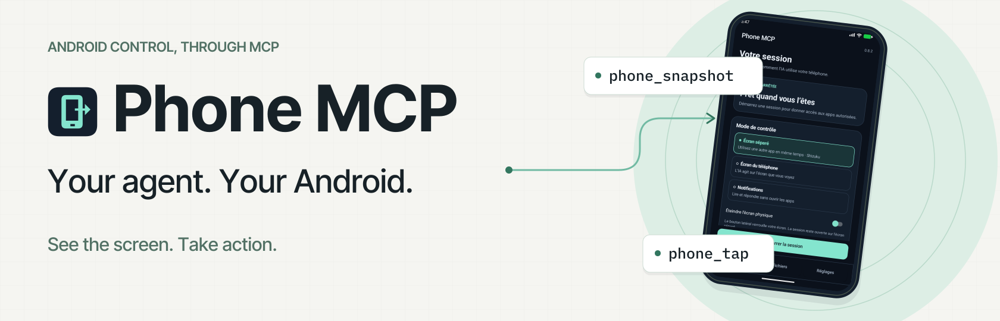
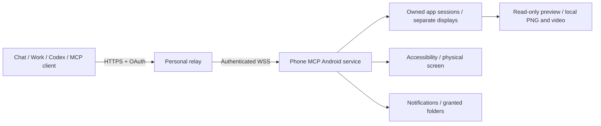
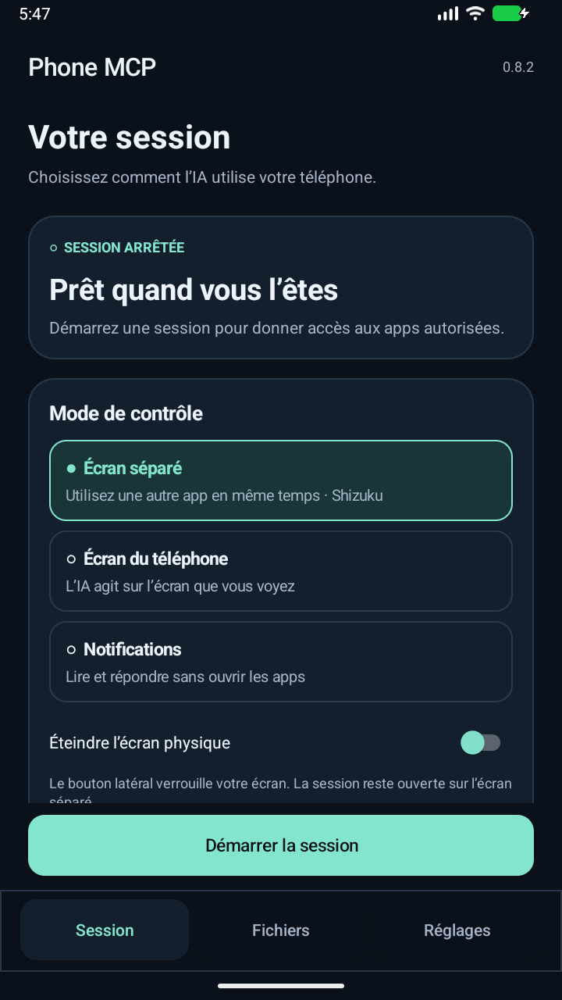
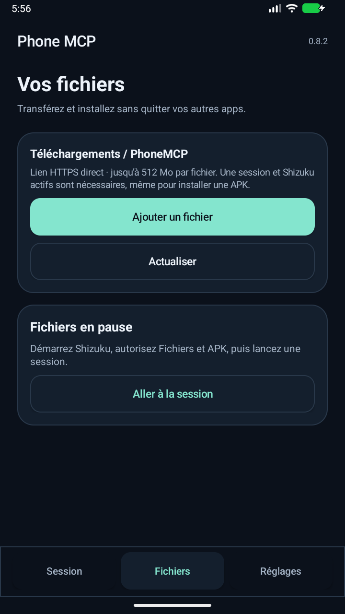
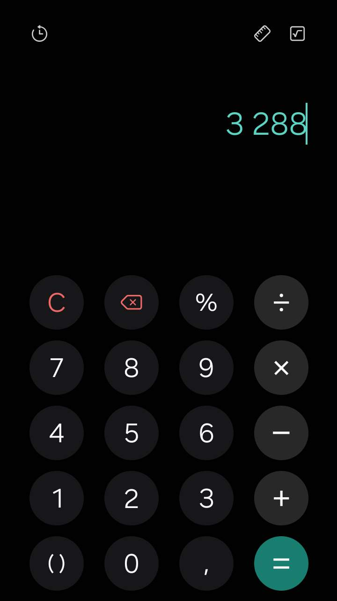

<div align="center">
<h1></h1>

**Give your AI a real Android phone to work with.**

Independent app sessions for agents. Keep using your phone. Read, tap, type and swipe.
Transfer local files, manage notifications, and capture only the AI app from its preview.

[**Download Android 0.16.2**](https://github.com/Mirochill/Phone-MCP/releases/download/v0.16.2/Phone-MCP-0.16.2.apk) · [**Installation**](docs/installation.md) · [**All 59 tools**](docs/tools-reference.md) · [**Agent setup prompt**](docs/agent-setup-prompt.md)


</div>

Phone MCP connects an Android companion to an AI client over authenticated [MCP](https://modelcontextprotocol.io/). Your personal relay exposes HTTPS tools; the phone connects outbound over WebSocket. Cloudflare hosting works while your PC is off. The AI runs in your chosen client; Phone MCP does not supply a model or keep a conversation running by itself.

This repository contains the current **editable Android source**, both relay implementations, locked dependencies, setup helpers, tests and the verified developer-signed APK. Version **0.16.2**, package `fr.phonemcp`, version code **65**. [Release notes](CHANGELOG.md) · [Source provenance](docs/source-provenance.md) · [Verification and limits](docs/verification.md).

## What is new since the first public release

- **Independent app/agent sessions:** one owned virtual display per session, explicit leases, concurrent routing, cancellation and cleanup. Same-app instances can have separate navigation where Android and the app support it; processes, account data and services remain shared.
- **Your phone stays usable:** optional read-only previews, per-session Stop and **Take control of this page**, transferring the existing task to your physical display. Ending a session removes its AI tasks and preview. A successful handoff ends the old session and allows a fresh AI session.
- **Local screen preference:** Keep the physical screen on is disabled by default and can only be enabled in Android settings. An agent cannot select a lit-screen fallback. Physical-panel-off gestures and normal side-button recovery were verified on the S24 Ultra; universal app/device behavior is not promised.
- **Capture inside the preview:** save a source-only PNG or record a silent MP4 of the AI app, without preview buttons or your physical screen. Recording continues when you close the viewer; files appear in the Gallery's PhoneMCP album. FR, EN, ES and DE interface text is included.
- **Faster local execution:** up to eight observed gestures in one action sequence, exact wait-and-click, reused observations and optional final screenshots. Model reasoning, network latency and app timers still matter.
- **Bounded ad closing:** local jobs handle available Skip/Close controls, successive ad pages, countdown waits and supported hidden controls. Status/cancel tools report progress. Completion means return to an observed app target, **not proof of a reward**; imposed timers are not bypassed.
- **Files without public hosting:** send a host-bound chat attachment or stream a local file through the paired relay. Existing HTTPS downloads, guarded APK installation, selected-folder access and Android Share inbox remain available.
- **59 discoverable tools:** one operation registry powers named tools and the stable `phone_catalog`, `phone_read`, `phone_action` gateways. [Complete schemas](docs/tools.json) are generated from actual MCP discovery.

## Install in five steps

1. **Deploy your own relay** using the [Cloudflare guide](docs/installation.md#option-a-cloudflare-workers-recommended), or the included local Node relay with an HTTPS tunnel.
2. **Install the APK** from [v0.16.2](https://github.com/Mirochill/Phone-MCP/releases/tag/v0.16.2). Verify [the APK checksum](releases/0.16.2/SHA256SUMS.txt). It is a developer-signed preview outside Google Play; Android enforces signing-certificate continuity.
3. **Pair your phone** with your relay's private one-use link/QR. Android uses the HTTPS origin; your AI client uses that origin plus `/mcp`. No maintainer endpoint or secret is included.
4. **Enable the capabilities you need:** Shizuku for separate-display control and transfer/install features, Accessibility for physical-screen control, notification access for notifications, and explicit folder grants for selected-folder tools. This preview defaults to making installed apps eligible: review and revoke apps/capabilities before starting.
5. **Start a session locally**, initially unlocked. Connect the client using OAuth, call `phone_connection` and `phone_status`, then create one app session per agent and keep its `sessionId` on every request. End finished app sessions with `phone_session_end`.

[Detailed Android/server setup](docs/installation.md) · [ChatGPT, Work, Codex and other clients](docs/clients.md) · [Copy-ready agent instructions](docs/agent-setup-prompt.md).

## Modes and control

| Mode | Screen | Requirements / behavior |
|---|---|---|
| Phone screen (`foreground`) | Your physical display | Accessibility; awake and unlocked. Shared navigation. |
| Separate screen (`parallel`) | A distinct owned display for each app session | Shizuku, initial unlock and compatible app/device. Your physical navigation can remain independent. |
| Notifications | No app window | Notification access and a supported action for replies. |

The connection itself does not keep the screen on. In Android **Settings → Screen during control**, the local keep-on preference decides whether active app sessions may hold the physical screen awake. `phone_session_wake` recovers the existing AI display under that preference; it cannot change it, relaunch an app or unlock Android.

Use **See app** or its **AI preview** Recents card to view a session. **Close preview** leaves the session working; **Stop AI control** revokes that control; **Take control of this page** stops the old session and moves the existing task to you without intentionally resetting its state. Explicit Stop requires local resumption; a successful page handoff permits a new session.

**Capture → Photo (PNG)** saves to `Pictures/PhoneMCP`. **Start video (no audio)** / **Stop and save video** saves MP4/AVC to `Movies/PhoneMCP`. The recording uses the owned AI display, continues away from the viewer, and has a stop-all notification. The S24 validation used 720×1280 source-only media. Capture grants, protected fields and source restrictions remain enforced; no physical-screen fallback is used.

## Exposed tools

| Area | Examples |
|---|---|
| Discovery and diagnostics | `phone_connection`, `phone_catalog`, `phone_read`, `phone_action`, `phone_status`, `phone_diagnostics`, `phone_diagnostic_probe` |
| Independent sessions | `phone_session_create`, `phone_session_list`, `phone_session_keepalive`, `phone_session_end`, `phone_session_cancel`, `phone_session_wake`, `phone_session_cleanup` |
| App interaction and images | snapshot, screenshot, find/wait, node details, open app/URL, click/tap/swipe/pinch, text editing, back, action sequence |
| Automatic ad closing | `phone_ad_start`, `phone_ad_status`, `phone_ad_cancel` |
| Notifications | read, inline reply, dismiss, snooze |
| Transfers and installation | `phone_send_file`, upload begin/commit, HTTPS download, files/jobs, guarded APK installation |
| Selected folders and Share inbox | list/read/write/delete in explicitly selected folders; read deliberately shared content |

[Every one of the 59 names and parameters](docs/tools-reference.md) · [Machine-readable schemas](docs/tools.json) · [Usage and error handling](docs/tools.md).

An older ChatGPT conversation may cache named-tool schemas. The stable gateways expose the current server registry; rediscover/refresh the connector for new host-native tool definitions, especially chat-file binding. The repository cannot force an existing conversation's tool cache to change. Preview PNG/video controls are **local Android UI features**, not additional remote tools.

## Verification and compatibility

The release APK, signature, alignment and build metadata were checked. On the S24 Ultra, source-only PNG and animated silent MP4 were verified, including recording the AI app while the user used the physical home screen. Prior device checks verified separate-session routing, retained calculator state, local handoff, dark-panel gestures and normal side-button recovery. Evidence is release-specific: see [verification](docs/verification.md).

Known limits include shared same-user app data/processes, app/OEM multi-display differences, intermittent third-party black rendering, app-imposed ad timers and unmeasured sustained frame rate or battery cost. PNG validation began on 0.16.0 with unchanged image code; video validation is on 0.16.2. Automatic finalization while a source session ends is implemented but that exact in-progress case remains unverified on hardware. Full APK self-updates interrupt running sessions and require reopening locally.

## Build and test

Node.js 22+, JDK 17, Android SDK Platform 36 / Build Tools 36.0.0. AGP 8.10.1 and Gradle 8.13 remain pinned.

```sh
git clone https://github.com/Mirochill/Phone-MCP.git
cd Phone-MCP
npm ci --prefix server
npm ci --prefix cloudflare
npm test
npm run test:policy
npm run test:android-doubles
npm run test:cloud
npm run check:docs
```

Build Android with `cd android` then `./gradlew --no-daemon assembleRelease lintRelease`, or `.\gradlew.bat --no-daemon assembleRelease lintRelease` in PowerShell. The preview configuration uses your local debug key; it will normally differ from the distributed APK's signer. [Build/signing details](docs/source-provenance.md).

The Windows `scripts/Build-Release.ps1` also verifies signature/alignment and prepares paired update assets. Use `-SkipUpdateAssets` to prepare a local candidate without replacing those assets. Publishing a GitHub release does not deploy a user's personal Worker.

## Architecture and security



One personal relay serves one owner and phone. Distinct app sessions have independent command lanes; same-session actions are serialized and a global control transition coordinates those lanes. OAuth ownership, app permissions and exact session/display/window guards remain enforced. The relay can see forwarded content; TLS transport is not end-to-end encryption against the relay operator. [Architecture](docs/architecture.md) · [Security](SECURITY.md).

App screens and file contents are untrusted data. User authorization for messages, purchases or deletions must come from the AI host and user. A delivered touch is not proof of application effect, an ad return is not a reward, and a queued file/install job is not completion.

## Watch it in motion

https://github.com/user-attachments/assets/1b6dd7ad-868c-4561-a8e3-cca08a2036df

*Historical 0.8.2 launch film, not a demonstration of every current feature. [MP4](https://github.com/Mirochill/Phone-MCP/releases/download/v0.8.2/phone-mcp-launch.mp4) · [Editable Remotion source](docs/media/remotion/README.md).*

<details><summary>Historical interface captures</summary>

  

These captures predate the new preview Capture menu and multilingual UI. The repository preserves their provenance; they are not new-release screenshots.
</details>

## Repository map

```text
android/       Original Java/AIDL/resources, pinned Gradle wrapper, policy tests
server/        Node relay, shared MCP registry, OAuth and tests
cloudflare/    Worker/SQLite Durable Object, pairing and runtime/update tests
scripts/       Setup, build, tests and generated tool-documentation checks
docs/          Installation, clients, complete schemas, verification and media
releases/      Current APK/metadata plus explicitly historical release artifacts
```

Created by [Mirochill](https://github.com/Mirochill). MIT licensed. Independent project; not affiliated with OpenAI, Google, Cloudflare or Shizuku. [Third-party notices](THIRD_PARTY_NOTICES.md).
